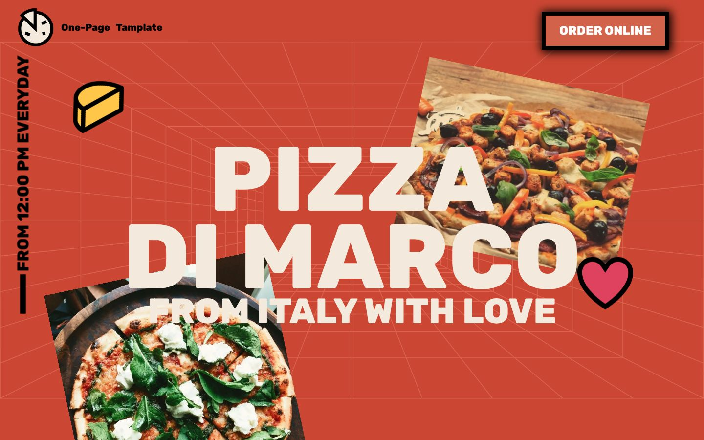
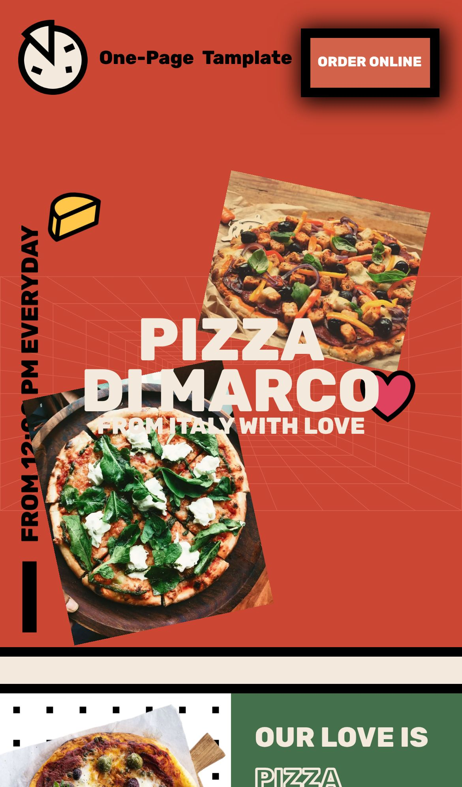
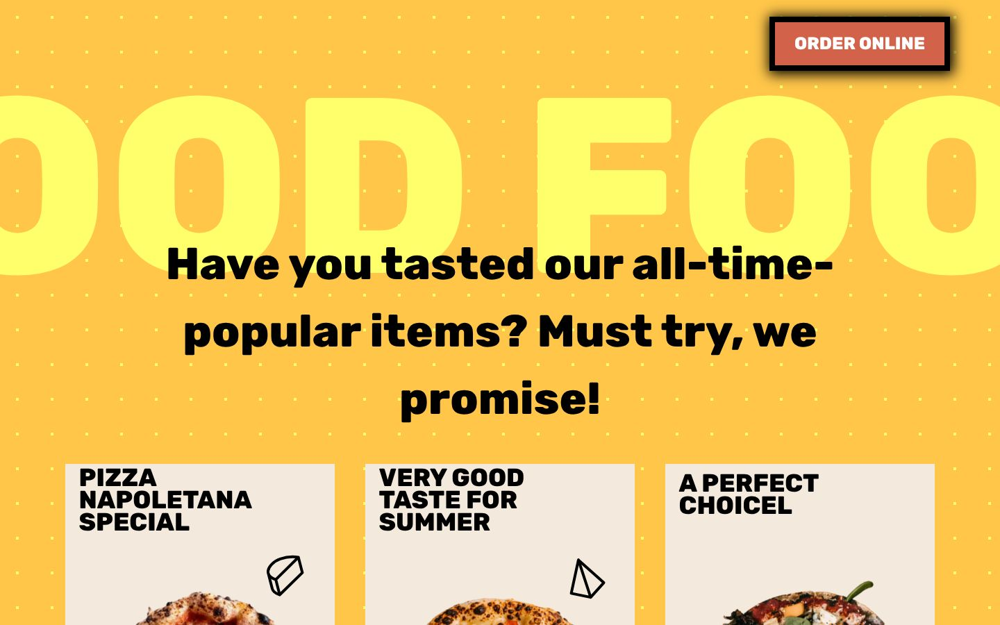
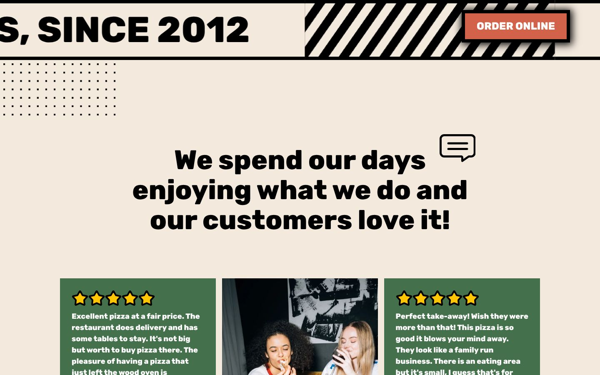

<div align="center">

# Pizza Di Marco

### Animated one-page pizza restaurant landing page

A bold, scroll-driven landing page for a fictional pizzeria, built with Tailwind CSS custom animations and a little vanilla JavaScript.

[](https://developer.mozilla.org/docs/Web/HTML)
[](https://tailwindcss.com)
[](https://developer.mozilla.org/docs/Web/JavaScript)
<br>
[](https://eslamraafat1.github.io/Pizza/)

**[Live demo](https://eslamraafat1.github.io/Pizza/)** ·
**[Portfolio](https://new-portfolio-ashy-xi.vercel.app/)** ·
**[LinkedIn](https://www.linkedin.com/in/eslamraafat-dev/)** ·
**[Email](mailto:eslamraafat736@gmail.com)**

<br>



</div>

<table>
  <tr>
    <td width="33%"></td>
    <td width="67%">
      <br><br>
      </td>
  </tr>
  <tr>
    <td align="center"><sub>Mobile (iPhone 13)</sub></td>
    <td align="center"><sub>Menu section · Reviews section</sub></td>
  </tr>
</table>

---

## Overview

A **practice project** (November 2023). I rebuilt the design of a one-page pizza restaurant template, "Pizza Di Marco", to practise Tailwind CSS, custom keyframe animations and scroll-based effects in plain JavaScript. It is not a real restaurant: the copy is template text (some of it is lorem ipsum), and the "Order online", newsletter and footer links are not wired up.

## Features

### Animated hero

- Two pizza photos fly in from opposite corners (`headImgTop` / `headImgBottom` keyframes), then rotate as you scroll.
- The perspective grid background fades in, and the title "PIZZA DI MARCO / FROM ITALY WITH LOVE" animates in on load.
- Floating cheese and heart icons on looping animations; a vertical "From 12:00 PM everyday" label and a fixed "Order online" button.

### Scroll effects (`src/js/master.js`)

- The page scrolls inside `<main>`, and one scroll listener drives every effect:
  - the hero images rotate based on scroll position,
  - the giant "GOOD FOOD" headline in the menu slides sideways,
  - red stars pop in when the "Slice to meet you" section comes into view,
  - three hearts "burst" when the reviews section is reached,
  - in the chef section (a sticky panel), the three chef photos rotate and slide up by different amounts using `data-rotate` attributes.

### Sections

- Endless ticker bands ("Slice to meet you!", "For foodies, since 2012") with a CSS `moveLine` animation.
- "Our love is pizza shaped" split block with an outlined-text effect.
- Chef story section on a sticky, bordered panel.
- Menu grid of six cards with slowly rotating dish images (`rotate360`).
- Customer review cards with star ratings and photos, plus a row of partner logos.
- Newsletter block, "Find us on" social links and a footer.

### Responsive layout

- Mobile-first Tailwind classes (`md:` / `lg:` breakpoints) and viewport-based font sizes (`vw`), so the big type scales with the screen.
- Some sections show fewer columns on small screens (for example, the third review column is desktop only).

## Tech stack

| Layer | Tools |
| --- | --- |
| Markup | HTML5 (single page) |
| Styling | Tailwind CSS 3.3.3, compiled to `src/css/output.css`, with custom colours, background images and 10 custom keyframe animations |
| Scripting | Vanilla JavaScript (`src/js/master.js`) |
| Fonts | Rubik (Google Fonts) |
| Icons | Bootstrap Icons 1.3.0 (CDN), custom SVG illustrations |
| Hosting | GitHub Pages |

## Project structure

```text
.
├── index.html            # the whole one-page site
├── src/
│   ├── css/
│   │   ├── master.css    # Tailwind input (@tailwind directives)
│   │   └── output.css    # compiled Tailwind CSS used by the page
│   ├── js/master.js      # scroll-driven animations
│   ├── img/              # photos (.webp) and SVG illustrations
│   └── font/             # Rubik font files (not referenced; the page loads Rubik from Google Fonts)
└── docs/screenshots/     # images used in this README
```

## Getting started

The compiled CSS is committed, so there is nothing to build. Clone the repo and open `index.html`, or serve the folder:

```bash
git clone https://github.com/Eslamraafat1/Pizza.git
cd Pizza
npx serve .        # or just open index.html
```

## Deployment

Deployed on **GitHub Pages** from the `master` branch: [eslamraafat1.github.io/Pizza](https://eslamraafat1.github.io/Pizza/).

## Author

**Eslam Raafat**, Front-End Developer (React · Next.js · TypeScript)

- **Portfolio:** [new-portfolio-ashy-xi.vercel.app](https://new-portfolio-ashy-xi.vercel.app/)
- **LinkedIn:** [linkedin.com/in/eslamraafat-dev](https://www.linkedin.com/in/eslamraafat-dev/)
- **GitHub:** [@Eslamraafat1](https://github.com/Eslamraafat1)
- **Email:** [eslamraafat736@gmail.com](mailto:eslamraafat736@gmail.com)
